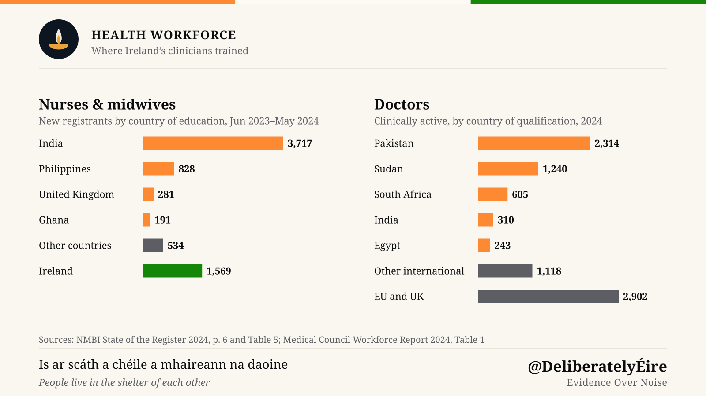
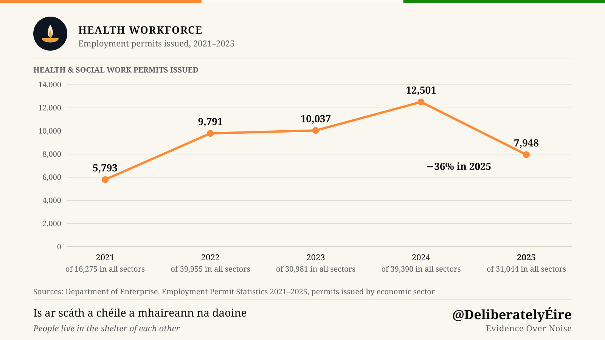

> **Key Takeaways**
> - 52% of practising nurses and midwives were educated outside Ireland (NMBI, June 2025). Among those working directly with patients, non-EU-educated nurses outnumber Irish-educated ones, 50% to 47%. India is the largest single source: in 2023–24, more new nurses trained there than in Ireland.
> - 43.4% of clinically active doctors qualified outside Ireland, and 29.5% outside Ireland, the EU and the UK (Medical Council, 2025). Pakistan and Sudan trained 62% of that last group.
> - The hospital workforce runs on two tracks: 68% of junior doctors on training schemes qualified in Ireland, while 67% of those outside training schemes are international graduates.
> - Without clinicians trained abroad, each nurse or midwife would serve 130 people instead of 63, and each doctor 433 instead of 245.
> - Recruitment is falling: health-sector employment permits dropped 36% in 2025, and new non-EU nurse registrants 38%. The citizenship Bill would raise the wait to apply from five years to eight.

## Who Is at the Bedside

Ask who is at the bedside in Ireland and the answer is as likely to be someone who trained abroad as someone who trained here. That is not an impression. It is what the two professional registers say. For nurses, the largest single source is India: more than one in five nurses and midwives on the register is an Indian national (NMBI, State of the Register 2025).

This article covers what the registers and permit data show, and what the health service would look like without these clinicians. It then sets out the immigration rules they work under and what the proposed citizenship changes would mean for them.

## Nurses: Half the Workforce Was Educated Abroad

The Nursing and Midwifery Board of Ireland (NMBI) publishes a census of its register every year. Its [State of the Register 2025](https://www.nmbi.ie/News/News/NMBI-State-of-the-Register-Reports-86,948-Nurses-a) counts **92,385** registered nurses and midwives on 1 June 2025, of whom **86,948** say they are practising.

Sorted by where they were educated, the practising workforce splits almost exactly in two:

| Country of education | Practising | Share | Patient-facing | Share |
|---|---|---|---|---|
| Ireland | 41,938 | 48% | 37,041 | 47% |
| Outside the EU | 42,432 | 49% | 39,760 | 50% |
| EU | 2,578 | 3% | 2,393 | 3% |

*Source: [NMBI State of the Register 2025](https://www.nmbi.ie/NMBI/media/NMBI/NMBI-State-of-the-Register-2025.pdf?ext=.pdf), Table 2.*

The patient-facing column is the one to read. Among registrants who say they work directly with patients, those educated outside the EU are the largest group.

By nationality, which is a different measure, Indian nationals are the second-largest group on the register after Irish nationals. There were **20,419** in 2025, or 22% of all registrants, nearly three times the next group of **7,324** Filipino nationals. Nationality is recorded at registration and is not the same as where someone trained, so the two tables should not be added together.

### Where new nurses come from

The flow of new registrants shows how recent this dependence is. In the twelve months to 31 May 2024, NMBI added **7,120** first-time registrants. Of these, **5,426** qualified outside the EU and **1,569** in Ireland ([State of the Register 2024](https://www.nmbi.ie/NMBI/media/NMBI/NMBI-State-of-the-Register-2024.pdf?ext=.pdf), Table 5). The single largest country of education was India, with **3,717** new registrants, more than twice the number of new Irish graduates. The Philippines (828), the United Kingdom (281) and Ghana (191) followed.

A year later the picture shifted. In the twelve months to 31 May 2025, non-EU first-time registrants fell to **3,345**, a drop of 38%, while Irish-educated registrants rose to **1,649**. NMBI's own summary notes "a decrease in the number of new registrants who were educated abroad" alongside steady growth in Irish graduates. In NMBI's 2025 report, India remained the top country of education for new registrants.

## Doctors: More Than Four in Ten Qualified Outside Ireland

The Medical Council's [Medical Workforce Intelligence Report 2025](https://www.medicalcouncil.ie/news-and-publications/publications/medical-workforce-intelligence-report-2025.pdf) counts **22,257** clinically active doctors in the Republic. By where they obtained their basic medical qualification:

- **12,599 (56.6%)** qualified in Ireland
- **3,090 (13.9%)** qualified in the EU or UK
- **6,568 (29.5%)** qualified outside Ireland, the EU and the UK

The Council calls the last group "international". It adopted that definition in its 2024 report: earlier editions counted any qualification from outside Ireland. On that older measure, 43.4% of clinically active doctors qualified abroad. The share of international graduates has climbed every year, from 23.3% in 2022 to 25.7% in 2023, 27.8% in 2024 and 29.5% in 2025. Citing 2024 research, the Council notes that Ireland has the fourth-highest proportion of foreign-educated doctors in the OECD.

Two countries dominate. **Pakistan** accounts for 2,741 of those doctors (41.7%), up 18% in a year from 2,314. **Sudan** accounts for 1,336 (20.3%). Together they trained 62% of Ireland's international medical graduates. South Africa (686), India (314) and Egypt (240) complete the top five.

### The training-scheme divide

The more revealing number sits inside the hospital grade structure. Non-consultant hospital doctors (NCHDs) are the junior and middle-grade doctors who staff wards and emergency departments under a consultant. Some are on a formal training scheme, the route toward specialist registration. Many are not.

In 2025, **5,034** of 9,568 NCHDs (52.6%) were not on a formal training scheme, up 5.6% on 2024. The Council's report sets out who fills each track:

- **68.0%** of NCHDs on a formal training scheme qualified in Ireland.
- **66.9%** of NCHDs not on a formal training scheme were international graduates.

The gap is narrowing slightly: international graduates made up 22.5% of NCHDs on training schemes in 2025, up from 17.1% in 2024.

The report notes a "continued reliance on doctors with international qualifications, many of whom are on the General Division of the Register and are concentrated in Model 2 and Model 3 hospitals." Those hospitals, it adds, are "also more reliant on Non-Consultant Hospital Doctors (NCHDs) who are not on a formal training scheme."

In practice, Irish graduates are concentrated on the track that leads to a consultant post. International graduates are concentrated on the track that keeps hospitals running.

## Where They Trained

Among nurses and midwives registering for the first time in 2023–24, India (3,717) far outnumbered the Philippines (828), the United Kingdom (281) and Ghana (191); 1,569 trained in Ireland. Among clinically active doctors in 2025, Pakistan (2,741) and Sudan (1,336) led, followed by South Africa (686), India (314) and Egypt (240), while 3,090 qualified in the EU or UK.

The two registers publish different measures, so the chart shows each on its own scale. For nurses, NMBI breaks down new registrants by country of education; for doctors, the Medical Council breaks down the whole clinically active workforce by country of qualification.

## What It Would Mean

Divide the population by the workforce and the scale becomes clear. With the CSO's [April 2025 population estimate](https://www.cso.ie/en/releasesandpublications/ep/p-pme/populationandmigrationestimatesapril2025/) of 5,458,600, there is one practising nurse or midwife for every 63 people. Leave only the Irish-educated, and it is one for every 130. For doctors, on the same population and the Medical Council's 2025 count, one for every 245 people becomes one for every 433. This is a thought experiment, not a forecast: it shows the share of care that rests on clinicians trained abroad.

That workforce is already stretched. On 24 September 2026, [NTPF open data](https://www.ntpf.ie/waiting-list-data/open-data/) counted 692,524 patients waiting for a first outpatient appointment, 124,709 of them for more than a year. Another 114,722 were waiting for inpatient or day-case treatment, and 43,288 for a GI endoscopy. The Department of Health puts the [weighted average wait across lists at 7.0 months](https://www.gov.ie/en/department-of-health/press-releases/monthly-waiting-list-figures-september-2026/).

No one can say how long these waits would become without the staff trained abroad. When capacity falls well below demand, a waiting list does not settle at a longer wait; it keeps growing until patients go elsewhere or go without care.

## The Permits They Arrive On

A doctor or nurse from outside the EU needs an employment permit and an immigration permission, and the type of each shapes everything from family life to the citizenship clock.

**Nurses** qualify for the **Critical Skills Employment Permit**, provided they hold "a third level degree or diploma accepted by the Nursing and Midwifery Board of Ireland" ([DETE](https://enterprise.gov.ie/en/what-we-do/workplace-and-skills/employment-permits/permit-types/critical-skills-employment-permit/)). Before 1 January 2020, diploma-qualified nurses could only get a General Employment Permit, which delayed family reunification by a year ([Department of Health](https://www.gov.ie/en/department-of-health/press-releases/minister-for-health-welcomes-changes-to-the-employment-permits-system-for-diploma-qualified-nursesmidwives/)). A Critical Skills permit allows immediate family reunification. After 21 months of employment the holder can upgrade to Stamp 4, which removes the need for any further employment permit, under the Immigration Service Delivery rule quoted below.

**Doctors** have had a harder path. A Critical Skills permit requires a two-year job offer, and NCHDs outside training schemes were historically hired on six-month or one-year contracts. They were placed on General Employment Permits instead, renewed with each move, while doctors on training schemes held Critical Skills permits. In 2021 the Irish Medical Organisation said Critical Skills permits [should be made more readily available to doctors](https://www.medicalindependent.ie/in-the-news/breaking-news/international-doctors-urge-access-to-critical-skills-permits).

In March 2022, the Government changed it. NCHDs in public hospitals now receive a two-year **multi-site General Employment Permit** that follows them between public hospitals, with a **Stamp 1H** immigration permission. Immigration Service Delivery says they become eligible for Stamp 4 "upon completion of 21 months from commencement of employment" on that permit ([ISD](https://www.irishimmigration.ie/registering-your-immigration-permission/how-to-renew-your-current-permission/information-on-stamp-4-upgrades/)). Their spouses and partners can hold Stamp 1G, with full access to the labour market ([DETE](https://enterprise.gov.ie/en/news-and-events/department-news/2022/march/08032022a.html)). The reform fixed the permit. It did not fix the training-scheme divide above.

### Permits fell sharply in 2025

The Department of Enterprise publishes permits issued by economic sector. The relevant sector is "Health & Social Work Activities", which covers healthcare assistants and care workers as well as doctors and nurses.

*Source: DETE Employment Permit Statistics, [2021](https://enterprise.gov.ie/en/publications/employment-permit-statistics-2021.html), [2022](https://enterprise.gov.ie/en/publications/employment-permit-statistics-2022.html), [2023](https://enterprise.gov.ie/en/publications/employment-permit-statistics-2023.html), [2024](https://enterprise.gov.ie/en/publications/employment-permit-statistics-2024.html), [2025](https://enterprise.gov.ie/en/publications/employment-permit-statistics-2025.html), permits issued by sector.*

For four years, health-sector permits rose every year, more than doubling from 5,793 in 2021 to 12,501 in 2024. In 2025 they fell 36%, to 7,948, against 21% across all sectors. That is below the 2022 level. Throughout, health took between a quarter and a third of all permits issued. 2021 was an unusually low year for permits overall, with fewer than half the 2022 total, so it is a weak baseline for measuring growth. These count permits issued, not people arriving. Separately, NMBI recorded a 38% fall in new non-EU-educated registrants in the twelve months to 31 May 2025. The periods differ, and neither dataset explains the fall, so this article does not guess.

## What the Citizenship Bill Would Change for Them

Time on an employment permit (Stamp 1) and on Stamp 4 counts as reckonable residence for naturalisation; time on a student permission (Stamp 2) does not ([ISD](https://www.irishimmigration.ie/how-to-become-an-irish-citizen-guide/)). Unlike a PhD researcher on Stamp 2, a doctor or nurse who arrives on a work permit starts the citizenship clock on day one. Our [comparison of citizenship pathways](/article/ireland-citizenship) shows that this puts a skilled worker in Ireland's fastest group today, at five years.

The Citizenship Bill 2026, if enacted as drafted, would change that. The [General Scheme](https://assets.gov.ie/static/documents/cadca21c/General_Scheme_of_the_Irish_Nationality_and_Citizenship_Amendment_Bill_2026.pdf) sets out the changes, and our [guide to the Citizenship Bill](/article/irish-citizenship-amendment-bill-2026) explains them in full:

- **Residence rises from five years to eight.** A nurse arriving from India in January 2026 could apply in 2031 under current law. Under the General Scheme, they would wait until 2034.
- **Language and civics tests become mandatory**, to standards the Minister has not yet set.
- **A minimum income test applies**, at a threshold not yet set. Its welfare and housing look-back is unlikely to bite for people in salaried clinical jobs, but the figure matters for lower-paid healthcare assistants.

The Bill is not law, and the details that matter most are left to regulations. But it lands on a workforce in which half of patient-facing nurses were educated outside the EU and more than one in five registered nurses is Indian. Over a quarter of its doctors qualified outside Ireland, the EU and the UK. The rules that decide whether they settle permanently are, in effect, health workforce policy.

---

*Figures are as published by each body at the dates stated. Register counts are self-declared at annual renewal and may contain minor discrepancies. This article is not legal advice.*

---

**Deliberately Éire**: making Irish public policy legible.
