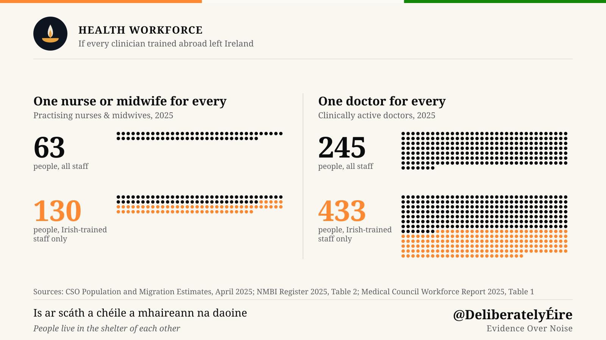
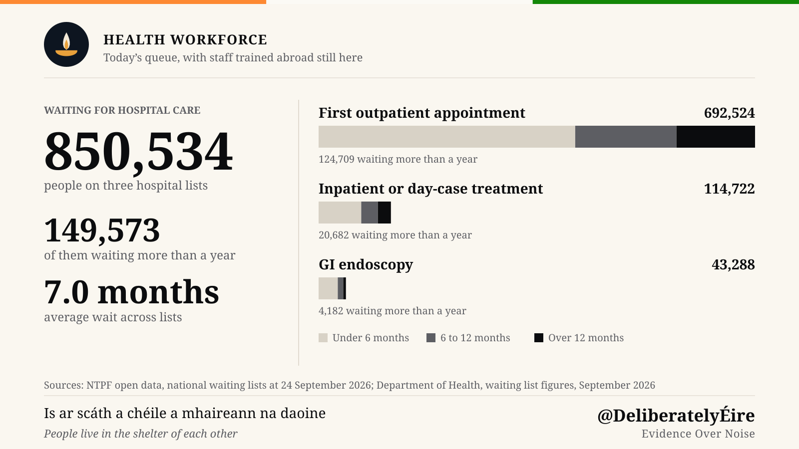

Ask who is at the bedside in Ireland and the answer is as likely to be someone who trained abroad as someone who trained here. Slightly more patient-facing nurses and midwives were educated outside Ireland than in it, and more than four in ten clinically active doctors qualified outside Ireland. That is not an impression. It is what the two professional registers say.

This article sets out what the registers and the permit data show about internationally educated doctors and nurses in Ireland, the immigration rules they work under, and what the proposed citizenship changes would mean for them.

> **Key Takeaways**
> - On 1 June 2025, 49% of practising nurses and midwives on the NMBI Register were educated outside the EU. Irish-educated registrants were 48%.
> - Among patient-facing nurses and midwives, non-EU-educated registrants outnumber Irish-educated ones, 50% to 47%.
> - In 2024, 27.8% of Ireland's clinically active doctors qualified outside Ireland, the EU and the UK, up from 23.3% in 2022. A further 13.8% qualified in the EU or UK.
> - Pakistan and Sudan account for 61% of those international medical graduates. Both are on the WHO's 2023 health workforce safeguards list.
> - Two-thirds of hospital doctors outside formal training schemes are international graduates.
> - Health-sector employment permits fell from 12,501 in 2024 to 7,948 in 2025, a sharper fall than permits overall.

Divide the population by the workforce and the scale becomes clear. With the CSO's [April 2025 population estimate](https://www.cso.ie/en/releasesandpublications/ep/p-pme/populationandmigrationestimatesapril2025/) of 5,458,600, there is one practising nurse or midwife for every 63 people. Leave only the Irish-educated, and it is one for every 130. For doctors, using the April 2024 population of 5,380,300 to match the 2024 register, one for every 257 people becomes one for every 440. This is a thought experiment, not a forecast: it shows the share of care that rests on clinicians trained abroad.

That workforce is already stretched. On 24 September 2026, [NTPF open data](https://www.ntpf.ie/waiting-list-data/open-data/) counted 692,524 patients waiting for a first outpatient appointment, 124,709 of them for more than a year. Another 114,722 were waiting for inpatient or day-case treatment, and 43,288 for a GI endoscopy. The Department of Health puts the [weighted average wait across lists at 7.0 months](https://www.gov.ie/en/department-of-health/press-releases/monthly-waiting-list-figures-september-2026/).

No one can say how long these waits would become without the staff trained abroad. When capacity falls well below demand, a waiting list does not settle at a longer wait; it keeps growing until patients go elsewhere or go without care.

## Nurses: Half the Workforce Was Educated Abroad

The Nursing and Midwifery Board of Ireland (NMBI) publishes a census of its register every year. Its [State of the Register 2025](https://www.nmbi.ie/News/News/NMBI-State-of-the-Register-Reports-86,948-Nurses-a) counts **92,385** registered nurses and midwives on 1 June 2025, of whom **86,948** say they are practising.

Sorted by where they were educated, the practising workforce splits almost exactly in two:

| Country of education | Practising | Share | Patient-facing | Share |
|---|---|---|---|---|
| Ireland | 41,938 | 48% | 37,041 | 47% |
| Outside the EU | 42,432 | 49% | 39,760 | 50% |
| EU | 2,578 | 3% | 2,393 | 3% |

*Source: [NMBI State of the Register 2025](https://www.nmbi.ie/NMBI/media/NMBI/NMBI-State-of-the-Register-2025.pdf?ext=.pdf), Table 2.*

The patient-facing column is the one to read. Among registrants who say they work directly with patients, those educated outside the EU are the largest group.

By nationality, which is a different measure, Indian nationals are the second-largest group on the register after Irish nationals: **20,419** in 2025, followed by **7,324** Filipino nationals. Nationality is recorded at registration and is not the same as where someone trained, so the two tables should not be added together.

### Where new nurses come from

The flow of new registrants shows how recent this dependence is. In the twelve months to 31 May 2024, NMBI added **7,120** first-time registrants. Of these, **5,426** qualified outside the EU and **1,569** in Ireland ([State of the Register 2024](https://www.nmbi.ie/NMBI/media/NMBI/NMBI-State-of-the-Register-2024.pdf?ext=.pdf), Table 5). The single largest country of education was India, with **3,717** new registrants, more than twice the number of new Irish graduates. The Philippines (828), the United Kingdom (281) and Ghana (191) followed.

A year later the picture shifted. In the twelve months to 31 May 2025, non-EU first-time registrants fell to **3,345**, a drop of 38%, while Irish-educated registrants rose to **1,649**. NMBI's own summary notes "a decrease in the number of new registrants who were educated abroad" alongside steady growth in Irish graduates. In NMBI's 2025 report, India remained the top country of education for new registrants.

## Doctors: More Than Four in Ten Qualified Outside Ireland

The Medical Council's [Medical Workforce Intelligence Report 2024](https://www.medicalcouncil.ie/news-and-publications/reports/medical-workforce-intelligence-report-2024.pdf) counts **20,962** clinically active doctors in the Republic. By where they obtained their basic medical qualification:

- **12,230 (58.3%)** qualified in Ireland
- **2,902 (13.8%)** qualified in the EU or UK
- **5,830 (27.8%)** qualified outside Ireland, the EU and the UK

The Council calls the last group "international". It changed that definition in this report: earlier editions counted any qualification from outside Ireland. On that older measure, 41.7% of clinically active doctors qualified abroad. The share of international graduates has climbed each year, from 23.3% in 2022 to 25.7% in 2023 and 27.8% in 2024.

Two countries dominate. **Pakistan** accounts for 2,314 of those doctors (39.7%), up 25% in a single year from 1,851. **Sudan** accounts for 1,240 (21.3%). Together they trained 61% of Ireland's international medical graduates.

### The training-scheme divide

The more revealing number sits inside the hospital grade structure. Non-consultant hospital doctors (NCHDs) are the junior and middle-grade doctors who staff wards and emergency departments under a consultant. Some are on a formal training scheme, the route toward specialist registration. Many are not.

In 2024, **4,767** NCHDs (53.3%) were not on a formal training scheme, up 12.6% on 2023. The Council's report sets out who fills each track:

- **73.0%** of NCHDs on a formal training scheme qualified in Ireland.
- **66.6%** of NCHDs not on a formal training scheme were international graduates.

The report is direct about what this means: "The majority of these NCHDs are doctors who have trained overseas, and many have not been able to access specialist training in Ireland." It adds that many work in Model 2 and Model 3 hospitals, which are "heavily reliant on NCHDs not on a formal training scheme."

In practice, Irish graduates are concentrated on the track that leads to a consultant post. International graduates are concentrated on the track that keeps hospitals running.

## The Permits They Arrive On

A doctor or nurse from outside the EU needs an employment permit and an immigration permission, and the type of each shapes everything from family life to the citizenship clock.

**Nurses** qualify for the **Critical Skills Employment Permit**, provided they hold "a third level degree or diploma accepted by the Nursing and Midwifery Board of Ireland" ([DETE](https://enterprise.gov.ie/en/what-we-do/workplace-and-skills/employment-permits/permit-types/critical-skills-employment-permit/)). Before 1 January 2020, diploma-qualified nurses could only get a General Employment Permit, which delayed family reunification by a year ([Department of Health](https://www.gov.ie/en/department-of-health/press-releases/minister-for-health-welcomes-changes-to-the-employment-permits-system-for-diploma-qualified-nursesmidwives/)). A Critical Skills permit allows immediate family reunification, and after 21 months of employment the holder can upgrade to Stamp 4, which removes the need for any further employment permit.

**Doctors** have had a harder path. A Critical Skills permit requires a two-year job offer, and NCHDs outside training schemes were historically hired on six-month or one-year contracts. They were placed on General Employment Permits instead, renewed with each move, while doctors on training schemes held Critical Skills permits. In 2021 the Irish Medical Organisation said Critical Skills permits [should be made more readily available to doctors](https://www.medicalindependent.ie/in-the-news/breaking-news/international-doctors-urge-access-to-critical-skills-permits).

In March 2022, the Government changed it. NCHDs in public hospitals now receive a two-year **multi-site General Employment Permit** that follows them between public hospitals, with a **Stamp 1H** immigration permission. Immigration Service Delivery says they become eligible for Stamp 4 "upon completion of 21 months from commencement of employment" on that permit ([ISD](https://www.irishimmigration.ie/registering-your-immigration-permission/how-to-renew-your-current-permission/information-on-stamp-4-upgrades/)). Their spouses and partners can hold Stamp 1G, with full access to the labour market ([DETE](https://enterprise.gov.ie/en/news-and-events/department-news/2022/march/08032022a.html)). The reform fixed the permit. It did not fix the training-scheme divide above.

### Permits fell sharply in 2025

The Department of Enterprise publishes permits issued by economic sector. The relevant sector is "Health & Social Work Activities", which covers healthcare assistants and care workers as well as doctors and nurses.

| Year | Health & Social Work permits | All permits | Health share |
|---|---|---|---|
| 2024 | 12,501 | 39,390 | 31.7% |
| 2025 | 7,948 | 31,044 | 25.6% |

*Source: DETE Employment Permit Statistics [2025](https://enterprise.gov.ie/en/publications/employment-permit-statistics-2025.html) and [2024](https://enterprise.gov.ie/en/publications/employment-permit-statistics-2024.html), permits issued by sector.*

Health-sector permits fell 36% in calendar 2025, against 21% across all sectors. These count permits issued, not people arriving. Separately, NMBI recorded a 38% fall in new non-EU-educated registrants in the twelve months to 31 May 2025. The periods differ, and neither dataset explains the fall, so this article does not guess.

## Whose Workforce Is It?

There is a second side to these numbers. The WHO publishes a [Health Workforce Support and Safeguards List](https://www.who.int/publications/i/item/9789240069787) of countries where the density of doctors, nurses and midwives is below the global median and universal health coverage is weakest. The 2023 edition lists 55 countries; WHO scheduled the next update for 2026.

**Pakistan and Sudan are both on it.** So are **Nigeria, Ghana and Zimbabwe**, which appear among the top nationalities on the nursing register. **India and the Philippines are not.**

The list does not prohibit migration. Health workers are free to move, and WHO's safeguards are aimed at *active* international recruitment from listed countries, not at individuals who choose to emigrate. Nothing in the data here shows how any individual doctor came to Ireland.

The Medical Council itself points to the issue. It explains that it narrowed its definition of "international" to focus on "a specific cohort of doctors who are more likely to have graduated in developing countries", which "can provide valuable information given the commitments set in the WHO Global Code of Practice on the International Recruitment of Health Personnel." Most of Ireland's international medical graduates qualified in two countries the WHO considers short of health workers themselves.

## What the Citizenship Bill Would Change for Them

Time on an employment permit (Stamp 1) and on Stamp 4 counts as reckonable residence for naturalisation; time on a student permission (Stamp 2) does not ([ISD](https://www.irishimmigration.ie/how-to-become-an-irish-citizen-guide/)). Unlike a PhD researcher on Stamp 2, a doctor or nurse who arrives on a work permit starts the citizenship clock on day one. Our [comparison of citizenship pathways](/article/ireland-citizenship) shows that this puts a skilled worker in Ireland's fastest group today, at five years.

The [Citizenship Bill 2026](/article/irish-citizenship-amendment-bill-2026), if enacted as drafted, would change that:

- **Residence rises from five years to eight.** A nurse arriving in January 2026 could apply in 2031 under current law. Under the General Scheme, they would wait until 2034.
- **Language and civics tests become mandatory**, to standards the Minister has not yet set.
- **A minimum income test applies**, at a threshold not yet set. Its welfare and housing look-back is unlikely to bite for people in salaried clinical jobs, but the figure matters for lower-paid healthcare assistants.

The Bill is not law, and the details that matter most are left to regulations. But it lands on a workforce in which half of patient-facing nurses were educated outside the EU and over a quarter of doctors qualified outside Ireland, the EU and the UK. The rules that decide whether they settle permanently are, in effect, health workforce policy.

---

*Figures are as published by each body at the dates stated. Register counts are self-declared at annual renewal and may contain minor discrepancies. This article is not legal advice.*

---

**Deliberately Éire**: making Irish public policy legible.
